# Quantum Key Distribution (QKD) Implementation

A practical implementation of Quantum Key Distribution using the ETSI QKD 014 standard with QuKayDee cloud simulator.

## 📚 Table of Contents

- [What is Quantum Key Distribution?](#what-is-quantum-key-distribution)
- [Why Do We Need QKD?](#why-do-we-need-qkd)
- [How Does It Work?](#how-does-it-work)
- [System Architecture](#system-architecture)
- [Implementation Overview](#implementation-overview)
- [Quick Start](#quick-start)
- [Understanding the Demonstrations](#understanding-the-demonstrations)
- [Real-World Applications](#real-world-applications)

---

## 🔐 What is Quantum Key Distribution?

**In Simple Terms:**

Imagine you want to send a secret message to your friend. Traditional encryption is like putting your message in a locked box. The problem? If someone steals the key, they can open the box later.

**Quantum Key Distribution (QKD)** is like a magical lock that:
- Automatically changes if anyone tries to peek at it
- Tells you immediately if someone tried to steal the key
- Uses the laws of quantum physics to be **theoretically unbreakable**

### The Quantum Advantage

Traditional encryption relies on **mathematical difficulty** (hard to break, but not impossible).

QKD relies on **physics laws** - specifically, the fact that observing a quantum particle changes it. It's not just hard to break; it's **physically impossible** without being detected.

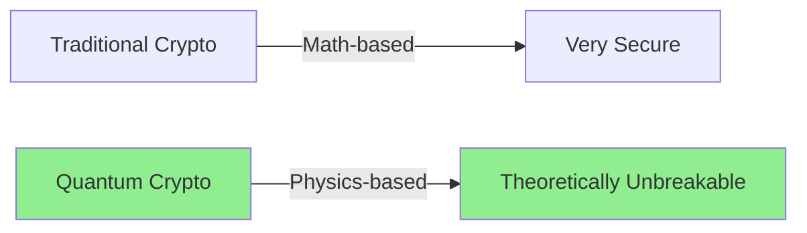

---

## 🌐 Why Do We Need QKD?

### The Quantum Threat

Current encryption (RSA, ECC) will be **broken** by quantum computers:

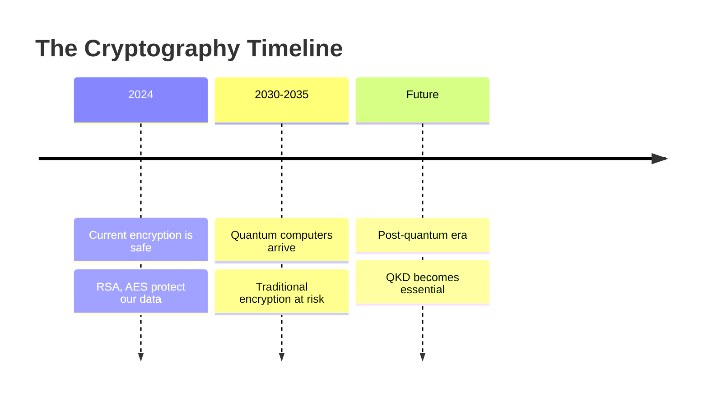

### The Solution

QKD provides:
- **Future-proof security** - Safe from quantum computers
- **Immediate detection** - Know if someone is eavesdropping
- **Perfect forward secrecy** - Old messages stay safe even if future keys are compromised

---

## ⚙️ How Does It Work?

### The Quantum Channel

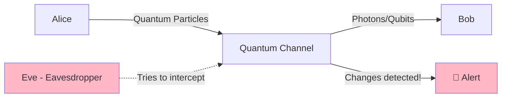

### Key Steps

1. **Alice sends quantum particles** (photons) to Bob
2. **Bob measures them** and records results
3. They **compare measurements** over a public channel
4. Any **interference is detected** (someone tried to spy!)
5. If safe, they use the measurements as a **shared secret key**

### The Physics Magic

**Heisenberg's Uncertainty Principle**: You can't measure a quantum particle without changing it.

This means:
- 👁️ Eve tries to read the quantum key
- 🔄 The quantum state changes
- 🚨 Alice and Bob detect the change
- 🗑️ They throw away that key and try again

---

## 🏗️ System Architecture

### ETSI QKD 014 Architecture

Our implementation follows the European Telecommunications Standards Institute (ETSI) standard for QKD APIs:

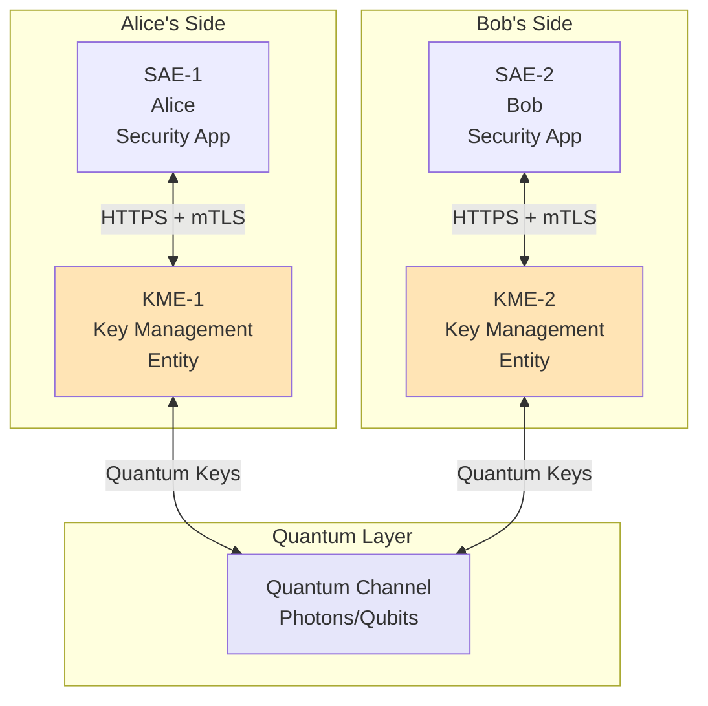

### Components Explained

| Component | What It Does | Example |
|-----------|--------------|---------|
| **SAE** (Secure Application Entity) | Your application that needs secure keys | Alice's banking app |
| **KME** (Key Management Entity) | Manages quantum keys | Key server |
| **Quantum Channel** | Transmits quantum particles | Fiber optic cable with photons |

### Our Configuration

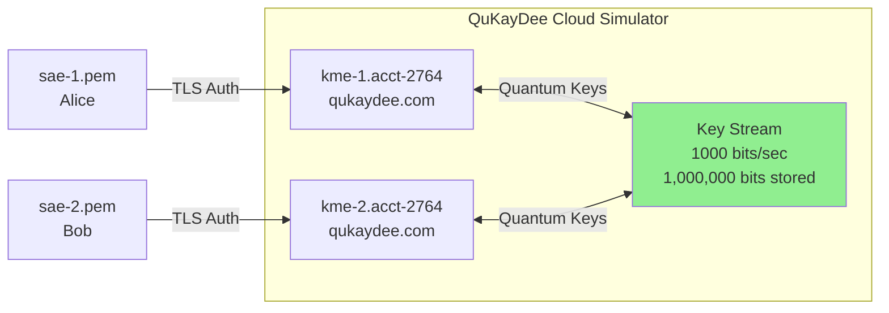

---

## 💻 Implementation Overview

### What `main.py` Does

The program implements **three ETSI QKD 014 API methods** with practical demonstrations:

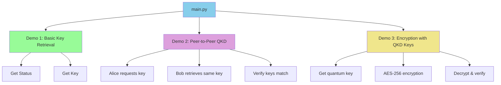

### The Three ETSI QKD 014 API Methods

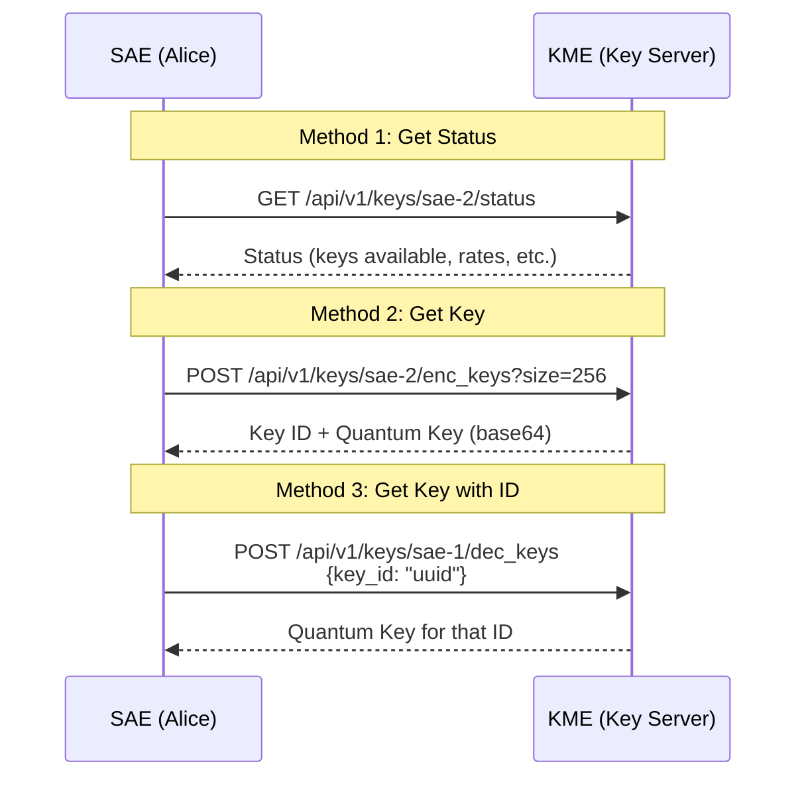

---

## 🚀 Quick Start

### Prerequisites

```bash
# Install required packages
pip install etsi-qkd-014-client cryptography requests
```

### Required Files

Ensure you have these certificate files in the same directory:
- `sae-1.pem` - Alice's client certificate
- `sae-2.pem` - Bob's client certificate
- `account-2764-server-ca-qukaydee-com.crt` - Server CA certificate

### Run the Program

```bash
python main.py
```

### Expected Output

```
QuKayDee QKD Client - Sample Implementation
Using ETSI QKD 014 Standard

============================================================
DEMO 1: Basic QKD Key Retrieval
============================================================
✓ All certificates found for sae-1
✓ Secure connection established (SSL verified)
✓ Connected to QuKayDee as sae-1

--- Server Status ---
✓ Status retrieved for sae-1
Status:
source_KME_ID : kme-1
target_KME_ID : kme-2
stored_key_count : 1953
key_size : 512

--- Key Retrieval ---
✓ Key retrieved: Key ID: b65e4228-c177-41d9-881f-db227aadfd7a
Key Size: 32 bytes
```

---

## 🎯 Understanding the Demonstrations

### Demo 1: Basic QKD Key Retrieval

**What it does:** Alice checks available quantum keys and retrieves one.

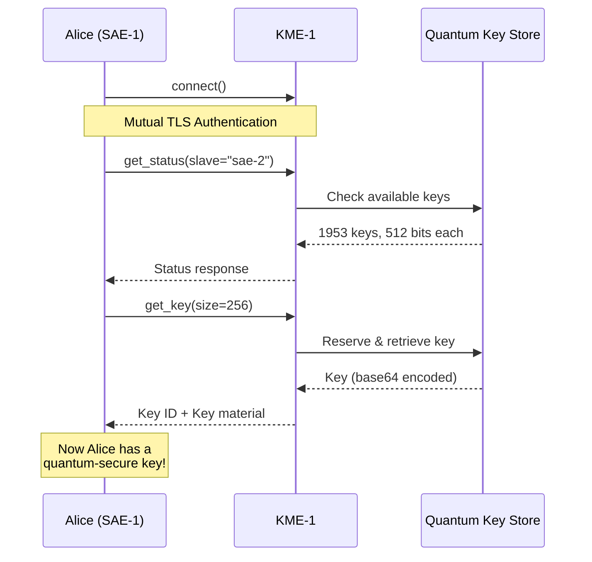

**Security Feature:** The key is retrieved over an encrypted channel (HTTPS + mTLS) but the key material itself came from quantum entanglement!

---

### Demo 2: Peer-to-Peer QKD

**What it does:** Shows how Alice and Bob can securely share the **exact same key**.

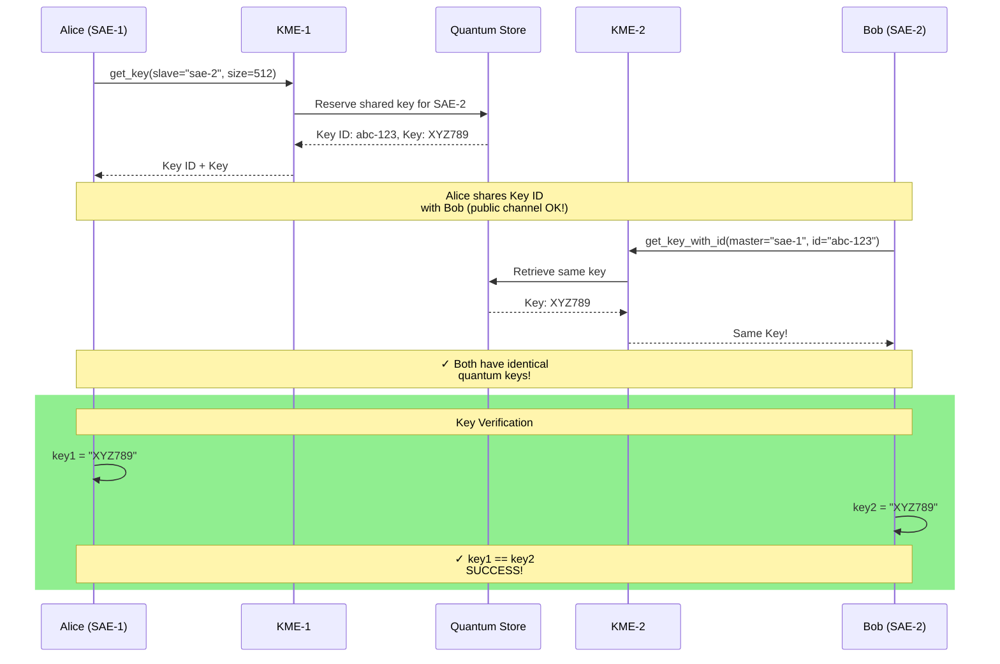

**Key Insight:**
- The key ID can be shared publicly (it's not secret)
- Only Alice and Bob can retrieve the actual key material
- Both get the **identical** quantum key

---

### Demo 3: Encryption with QKD Keys

**What it does:** Uses a quantum key to encrypt data with AES-256.

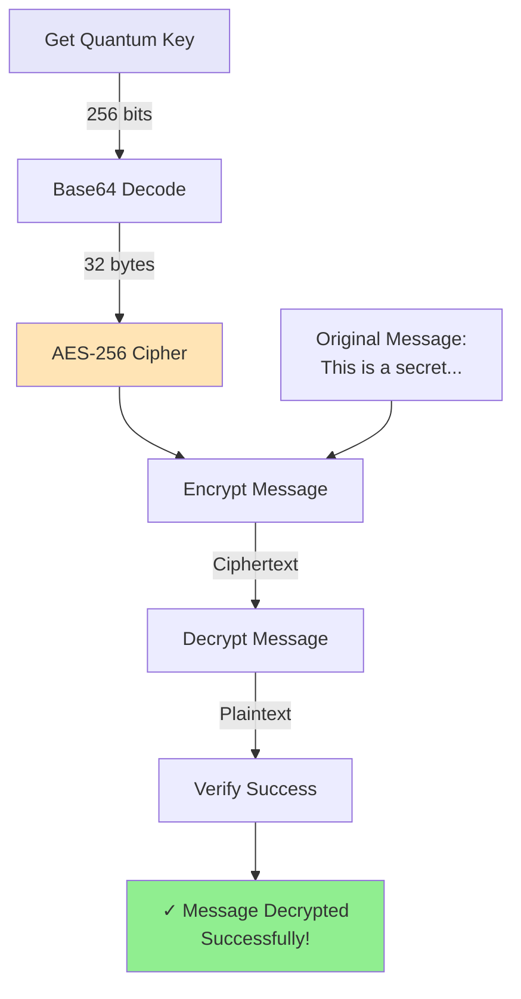

**How It Works:**

1. **Retrieve quantum key** (256 bits from QKD)
2. **Generate random IV** (Initialization Vector)
3. **Encrypt with AES-256-CBC** using the quantum key
4. **Decrypt** using the same quantum key + IV
5. **Verify** the decrypted message matches original

**Security Properties:**

- 🔐 AES-256 encryption strength
- 🎲 Quantum key provides perfect randomness
- 🛡️ Protected against future quantum computer attacks
- 🔔 Any key compromise would have been detected during QKD

---

## 🔍 Code Structure

### Main Components

```python
# 1. QuKayDeeClient Class
class QuKayDeeClient:
    def __init__(self, sae_id, kme_hostname=None)
    def connect()                              # Establish secure connection
    def get_status(slave_sae_id)              # ETSI Method 1
    def get_key(slave_sae_id, size, number)   # ETSI Method 2
    def get_key_with_id(master_sae_id, key_id) # ETSI Method 3

# 2. Demonstration Functions
def demonstrate_qkd_basic()           # Demo 1: Status + Key retrieval
def demonstrate_qkd_peer_to_peer()    # Demo 2: Alice ↔ Bob key sharing
def demonstrate_qkd_encryption()      # Demo 3: Encrypt with quantum key

# 3. Main Entry Point
def main()                            # Runs all three demonstrations
```

### Configuration (Auto-detected)

```python
# SAE-to-KME Mapping
sae-1 → kme-1.acct-2764.etsi-qkd-api.qukaydee.com
sae-2 → kme-2.acct-2764.etsi-qkd-api.qukaydee.com

# Certificates
sae-1.pem → Alice's client certificate
sae-2.pem → Bob's client certificate
account-2764-server-ca-qukaydee-com.crt → Server CA
```

---

## 🌍 Real-World Applications

### Where QKD is Used Today

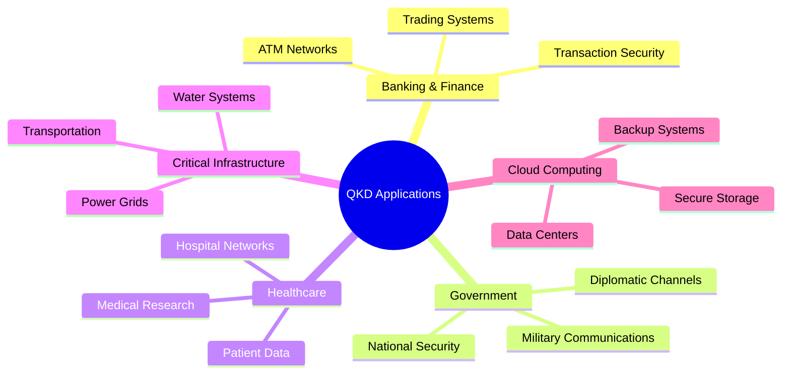

### Actual Deployments

| Location | Network | Description |
|----------|---------|-------------|
| 🇨🇳 **China** | Beijing-Shanghai | 2,000+ km QKD network |
| 🇪🇺 **Europe** | OPENQKD | Multi-country QKD network |
| 🇰🇷 **South Korea** | SK Telecom | Commercial QKD service |
| 🇺🇸 **USA** | Battelle | Smart grid protection |
| 🇨🇭 **Switzerland** | ID Quantique | Banking sector QKD |

### Future Vision

**2025-2030:**
- QKD integrated into 5G/6G networks
- Satellite-based global QKD
- Consumer-level QKD devices

**2030-2040:**
- Quantum internet becomes reality
- Post-quantum cryptography standard
- QKD in everyday devices

---

## 🔬 Technical Details

### Security Features

#### 1. Mutual TLS Authentication (mTLS)

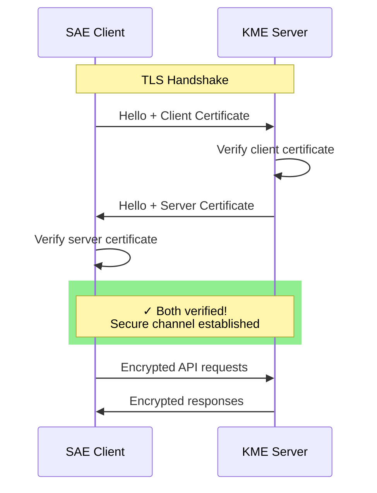

**What we verify:**
- ✓ Client certificate is valid (issued by trusted CA)
- ✓ Server certificate is valid (matches KME hostname)
- ✓ Both certificates haven't expired
- ✓ TLS 1.2+ is used

#### 2. Key Properties

| Property | Value | Description |
|----------|-------|-------------|
| **Key Rate** | 1000 bits/sec | Speed of key generation |
| **Key Size** | 1-100000 bits | Configurable per request |
| **Expiry Time** | 60 seconds | Key lifetime |
| **Stored Keys** | 1,000,000 bits | Pre-generated buffer |
| **Encoding** | Base64 | Key transmission format |

#### 3. API Response Codes

```python
# Success
200 OK               # Request successful, key retrieved

# Client Errors
400 Bad Request      # Invalid parameters
401 Unauthorized     # Authentication failed
404 Not Found        # SAE or key not found

# Server Errors
503 Service Unavailable  # No keys available, QKD link down
```

---

## 📊 Key Stream Configuration

### Current Setup

```
Key Stream ID: 200
Connected SAEs: Alice (sae-1) ↔ Bob (sae-2)
Key Rate: 1000 bits/second
Key Expiry: 60 seconds
Storage: 1,000,000 bits (1953 keys @ 512 bits each)
```

### What This Means

**1000 bits/sec key rate:**
- Generates a new 256-bit key every 0.25 seconds
- Generates a new 1024-bit key every second
- Fast enough for real-time applications

**60 second expiry:**
- Keys are automatically deleted after 1 minute
- Ensures forward secrecy
- Prevents key hoarding attacks

**1,000,000 bits storage:**
- ~1953 keys of 512 bits each
- Buffer for burst requests
- ~16 minutes of keys at full rate

---

## 🎓 Learning Resources

### Understanding QKD

1. **Basic Concepts**
   - Quantum mechanics principles
   - Photon polarization
   - BB84 protocol

2. **ETSI Standards**
   - ETSI GS QKD 014: REST API
   - ETSI GS QKD 004: Application interface
   - ETSI GS QKD 015: YANG data models

3. **Implementation**
   - Python etsi-qkd-014-client library
   - OpenSSL for TLS/mTLS
   - AES for symmetric encryption

### Further Reading

- 📘 **ETSI QKD 014 Specification**: Official standard document
- 🌐 **QuKayDee**: https://qukaydee.com (Cloud QKD simulator)
- 📚 **Quantum Cryptography**: "Quantum Computing for Everyone" by Chris Bernhardt
- 🔬 **Research Papers**: arXiv quantum cryptography section

---

## 🎯 Summary

### What You've Learned

✅ **Quantum Key Distribution** is physics-based, not math-based security
✅ **ETSI QKD 014** provides a standard API for QKD systems
✅ **Three API methods** enable status checks, key retrieval, and key sharing
✅ **QuKayDee** simulates a real QKD network in the cloud
✅ **Practical applications** include secure communication and encryption

### Key Takeaways

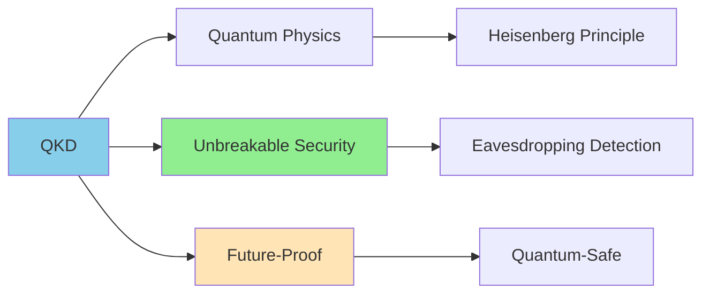

### The Bottom Line

**Traditional Crypto:** "This is really hard to break... probably."
**Quantum Crypto:** "Breaking this violates the laws of physics."

That's the QKD advantage! 🚀

---

## 📝 License & Credits

**Implementation**: Custom educational implementation
**Standard**: ETSI GS QKD 014 V1.1.1 (2019-02)
**Simulator**: QuKayDee Cloud Platform
**Library**: etsi-qkd-014-client by Yoann Piétri

---

**Built with ❤️ for quantum-safe security education**
